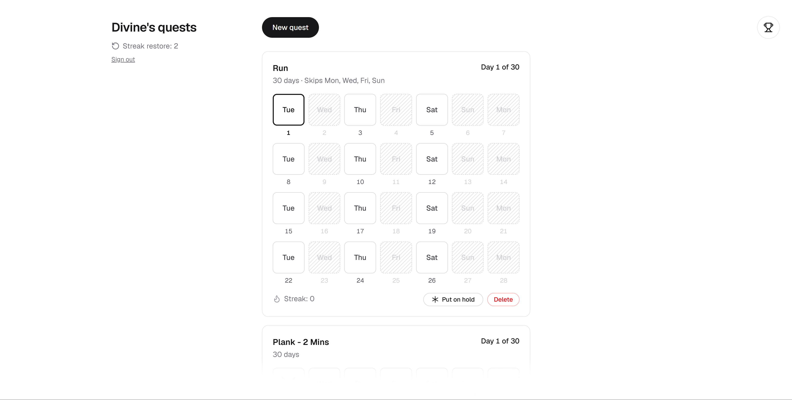
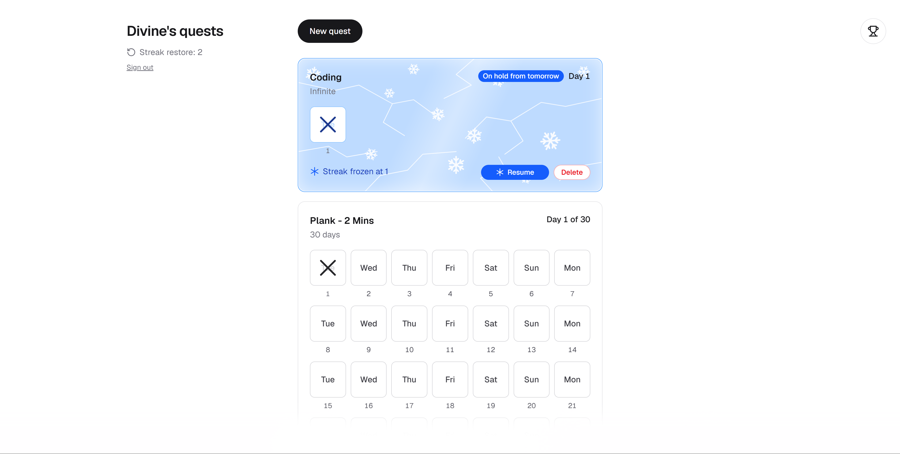
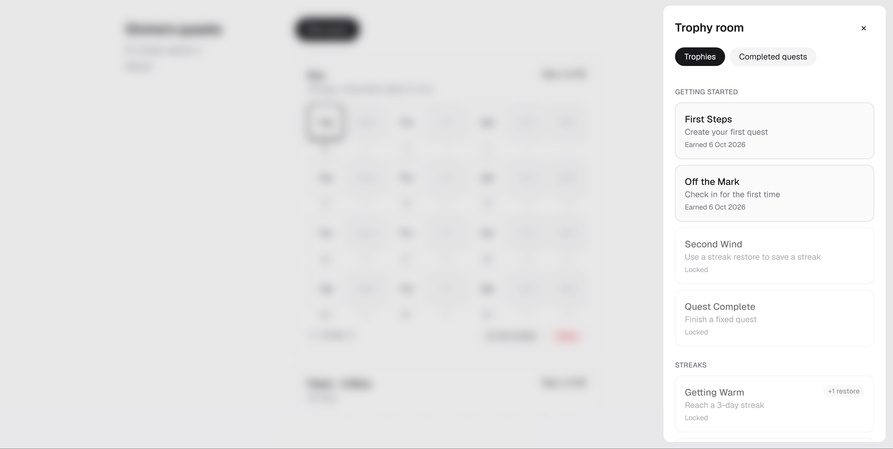
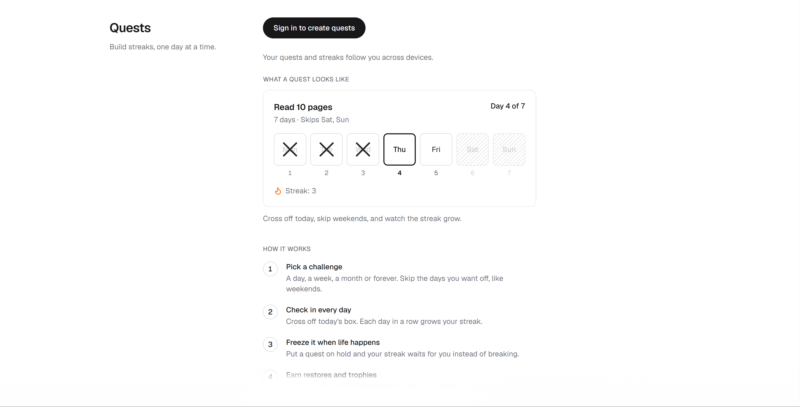

# Quests

> A habit tracker where streaks can freeze, break, and be won back.

**Live:** [quests.divineobeten.xyz](https://quests.divineobeten.xyz)


## Why this exists

Quests started as a small idea: a box to cross off for each day of a goal, and a missed day that you can recover from instead of one that ends everything. It was built because I kept misplacing the books I used for keeping track of my challenges and goals.

## Screenshots

| Your quests | A frozen quest |
| --- | --- |
|  |  |

| Trophies | Home |
| --- | --- |
|  |  |

## Features

- **Quests of any length:** a day, a week, a month, a custom number of days (up to 365) or no end date at all.
- **Day boxes you cross off:** the weekday sits in the box, the day number underneath, and an X draws itself when you check in.
- **Skip days:** choose weekdays to skip (weekends, Tuesdays, whatever). Skipped days never break a streak and don't count towards the length.
- **Freeze a quest:** put a quest on hold and the days you're away are neither missed nor counted. The card turns blue and frosts over.
- **Streak restores:** miss up to three days and spend a restore to keep the streak. After that, restart or delete the quest.
- **Trophies that pay out:** 24 trophies across four ladders (getting started, streaks, quests completed, check-ins in one day), paying 0 to 5 restores each.
- **Completed quests:** a list with dates, check-ins, best streak and how many days were restored, skipped or held.
- **Sync across devices** with Google sign-in.
- **Installable (PWA):** add Quests to your home screen or desktop and it opens like an app.
- **Works offline:** check in, hold, restore or add quests with no connection. Changes are kept on the device and sync, in order, when you're back online.
- **Cards that show their state:** white when healthy, blue when frozen, grey when a restore can save it, red when it can't.
- **Details:** toasts that name the quest, confirm dialogs for destructive actions, a page that doesn't scroll behind open dialogs, and a favicon of its own.

## How the rules work

| Rule | Behaviour |
| --- | --- |
| Streak | Consecutive covered days (checked in or restored). Skipped and held days are bridged, so they neither add to a streak nor break it. |
| Restore window | A quest missed for 1 to 3 days is *broken*: spend a restore to forgive the gap. At 4 or more days it is *lapsed*: restart or delete it. |
| Earning restores | Finish a fixed quest (+1). Reach every 25th day of an infinite quest (+1). Unlock trophies (+1 to +5). |
| Completion | A fixed quest is complete when every non-skipped day in its window is covered. Held days push the window out. |
| Holding | Only an active quest can be held. If you've already checked in today, the hold starts tomorrow and today's check-in stands. |

## Tech stack

| Layer | Choice |
| --- | --- |
| Framework | Next.js (App Router), React 19, TypeScript |
| Styling | Tailwind CSS v4, Geist |
| Client state | Zustand, with optimistic updates |
| Backend | Next.js Server Actions |
| Database | PostgreSQL (Supabase), Drizzle ORM, SQL migrations in `drizzle/` |
| Auth | Auth.js (next-auth v5), Google sign-in, JWT sessions |
| PWA | Web app manifest, hand-written service worker, install prompt |
| Motion | GSAP Flip for list reordering, CSS keyframes for everything else |
| Testing | Vitest, Testing Library, happy-dom |

## Project structure

```
src/
  app/                  Routes, layout, global styles, Auth.js route handler, favicon
  components/           UI: AppShell, QuestCard, NewQuestModal, TrophyPanel, FrostOverlay, ...
  features/quests/      Zustand store, server actions, client API, GSAP reorder hook
  lib/
    pwa/                Install prompt store and hook
    domain/             Pure logic: dates, quest rules, boxes, trophies, transitions (+ tests)
    db/                 Drizzle schema, state loading and saving, diffing
    useScrollLock.ts    Locks page scrolling behind dialogs
    useLingering.ts     Keeps something mounted briefly so it can fade out
  auth.ts               Auth.js configuration
public/
  sw.js                 Service worker (static files, one saved home page, offline page)
  offline.html          Shown offline before the app has ever been opened online
  icons/                App icons, including a maskable one
drizzle/                Generated SQL migrations
docs/                   Screenshots and the freeze demo
```

## Getting started

### Prerequisites

- Node.js 20.19+ (or 22.12+)
- A PostgreSQL database (a free Supabase project works well)
- A Google OAuth client

### 1. Clone and install

```bash
git clone https://github.com/<your-username>/quests.git
cd quests
npm install
```

### 2. Configure the environment

```bash
cp .env.example .env.local
```

On Windows PowerShell: `Copy-Item .env.example .env.local`

| Variable | What it is |
| --- | --- |
| `DATABASE_URL` | PostgreSQL connection string. With Supabase, use the **Session pooler** string, which works on IPv4 networks. |
| `AUTH_SECRET` | A random secret for signing sessions. Generate one with `npx auth secret`. |
| `AUTH_GOOGLE_ID` | Google OAuth client ID. |
| `AUTH_GOOGLE_SECRET` | Google OAuth client secret. |

If the database driver reports a self-signed certificate error, adding `?sslmode=no-verify` to `DATABASE_URL` gets you going locally. For production, use your provider's CA certificate instead.

**Google OAuth:** in the Google Cloud Console (Google Auth Platform), create a *Web application* client and add `http://localhost:3000/api/auth/callback/google` as an authorized redirect URI. While the consent screen is in Testing mode, only the test users you list can sign in.

### 3. Create the tables and run it

```bash
npm run db:migrate
npm run dev
```

Open [http://localhost:3000](http://localhost:3000).

## Scripts

| Script | What it does |
| --- | --- |
| `npm run dev` | Start the dev server |
| `npm run build` / `npm start` | Production build and server |
| `npm test` | Run the whole test suite once |
| `npm run test:watch` | Tests in watch mode |
| `npm run typecheck` | TypeScript, no emit |
| `npm run lint` | ESLint |
| `npm run format` | Prettier |
| `npm run db:generate` | Generate a migration from `schema.ts` |
| `npm run db:migrate` | Apply migrations |
| `npm run db:studio` | Open Drizzle Studio |

## Testing

The tests follow the architecture:

- **Domain:** streaks, restore windows, skips, holds, trophies, quest creation and the day-box layout, as plain functions with fixed dates.
- **Shared transitions:** the messages users see and the restores trophies pay out.
- **Persistence diffing:** `diffState` tests pin down exactly which rows each action changes.
- **Store:** optimistic updates and failure recovery, using an injected clock and a fake API, so no test touches the network.
- **Components:** Testing Library with happy-dom. Elements are found by role and accessible name, so restyling doesn't break tests.

```bash
npm test
```

## Deployment

The live site runs on Vercel with a Supabase database at [quests.divineobeten.xyz](https://quests.divineobeten.xyz).

1. Import the repository into Vercel and set the four environment variables above.
2. Add the `quests.divineobeten.xyz` domain in Vercel and create the DNS record it shows.
3. Run `npm run db:migrate` against the production database.
4. In the Google Cloud Console, add `https://quests.divineobeten.xyz/api/auth/callback/google` as an authorized redirect URI, and publish the consent screen so sign-in isn't limited to test users.

## Installing it as an app

Quests is a progressive web app. In Chrome and Edge an **Install** button appears in the header; on iOS use Share, then Add to Home Screen. It then opens in its own window without browser chrome.

What the service worker does, and deliberately doesn't do:

- It caches the app's scripts, fonts and icons, plus one copy of the home page, so the app opens without a connection after a first online visit.
- Page navigations go to the network first. The saved copy is only a fallback, and it is replaced on every online visit.
- Signing out deletes the saved page and the quests kept on the device, so a shared device never shows the previous person's data.
- It never touches saves (POSTs), the sign-in routes or other websites.

### Offline changes

Every change is applied to the screen immediately, written to `localStorage`, and put in an outbox. The outbox is sent in order through the same server actions, so the server re-runs the same rules (`transitions.ts`) against its own data. If the server rejects a queued change (the quest was deleted on another device, say), that change is dropped, the rest carry on, and the screen refreshes from the server with a note. Signing out is blocked while changes are unsent, so nothing is lost.

The service worker only registers in production builds, so to try it locally run `npm run build` then `npm start`. Browsers treat `localhost` as secure, so no HTTPS setup is needed.

## Accessibility and motion

- Dialogs and the trophy panel have roles and accessible names, close with Escape, and the page behind them doesn't scroll.
- Closed panels are removed from the tab order and the accessibility tree.
- Controls are real buttons with accessible names. The day boxes read as decoration, and the check-in control announces itself as "Check in today".
- `prefers-reduced-motion` stops the animations (the frost, the crossing-off X, the fades) and leaves the end state in place.

## Author

Built by [Divine Obeten](https://divineobeten.xyz), a design engineer working where engineering craft and design sensibility meet.

## License

MIT. Add a `LICENSE` file to the repository root to make it official.
